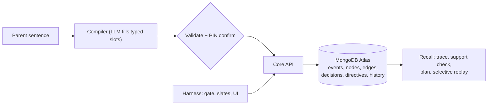

# 🧠 Governed Memory Core

**Agent memory you can actually govern.** Fix it, expire it, prove it.

Built at the **MongoDB Agents in Context Toronto Hackathon** (14 Nov 2026), track **Memory You Can Govern**.

## The problem (ELI5)

AI agents remember things. Sometimes they remember the *wrong* thing, or something they should never have stored, or something that should have expired. Today, fixing that usually means "delete it and hope nothing else depended on it."

We make memory behave like a system you can audit:

- **Retract** one memory and only the decisions that *depended* on it get redone.
- **Keep** decisions that have independent support.
- **Block** restricted content *before* it ever becomes a memory.
- **Expire** things on a clock, with dependents cleaned up the same way.
- **Explain** every action ("why did you recommend this?") from an audit ledger.

## See it work (about 3 minutes)

1. **Any domain in a sentence.** Describe a domain, an LLM fills a data-only *pack*, and a domain-neutral test suite must pass 5/5 before it activates.
2. **The hero demo: a parental-monitoring video recommender.** The judge plays the parent:
   - A child's feed is shaped by watch history.
   - The parent types a plain-language rule ("no scary stuff for a week"), confirms it with a PIN, and the feed changes with a receipt.
   - The parent un-recommends a video. Only the dependent items are replaced, and an independently supported item survives.
   - A with/without diff and a "why this?" view show the proof.

## How it works



- **Core:** generic, with no domain words. It owns the provenance graph (`$graphLookup`), the support check, the retraction planner, selective replay, TTL and the audit ledger.
- **Pack:** plain data (about 8 slots: types, gate, decay, scope, directive vocabulary, labels). A new domain needs no core change.
- **Harness:** the video-recommender demo, talking to the core only through the API.
- **The LLM never enforces anything.** It fills slots. Code validates, a human confirms, and code enforces the gate, planner and expiry.

Recall is based on dependency-guided rollback repair: trace the fault through a typed memory-to-action graph, keep what has independent support, and replay only what lost it.

## Stack

MongoDB Atlas (Vector Search, `$graphLookup`, TTL) · Voyage embeddings · Python (FastAPI) · LangChain + LangSmith · Groq `gpt-oss-120b` (OpenRouter fallback) · light JavaScript UI · optional Rust planner crate.

## Run it

```bash
git clone https://github.com/aniketqxp/mongodb-hackathon && cd mongodb-hackathon
cp .env.example .env            # fill in keys (never commit .env)
python3 -m venv .venv && source .venv/bin/activate
pip install -r mock/requirements.txt -r compiler/requirements.txt

uvicorn mock.app:app --port 8001      # terminal 1: mock core API
python3 ui/server.py                  # terminal 2: UI at http://127.0.0.1:8080
python3 -m pytest -q                  # tests
python3 data/seed.py --dry-run        # validate the synthetic seed data
```

The compiler service runs with `uvicorn compiler.app:app --port 8002`.

## Repo map

| Path | What |
| --- | --- |
| `core/` | Recall mechanism and real API (Aniket) |
| `compiler/` | Sentence → directive / pack compilers (David) |
| `eval/` | Prompt dataset and with/without-memory evals (David) |
| `harness/`, `ui/` | Gate, slates and the typed UI (Jasmine) |
| `data/` | 200 synthetic videos, demo pack, seed graph, retract scenario |
| `rust/` | Optional `recall-core` planner crate |
| `mock/`, `shared/`, `scripts/` | Mock API, `get_llm()`, precommit checks |
| `OPS/` | Contract, owners, status, blockers, kickoff |
| `docs/` | [Technical documentation](docs/TECHNICAL_DOCUMENTATION.md) |

## Guardrails

- **Synthetic data only.** No real people, no real children's data.
- The PIN is a demo gate, not real authentication.
- The system claims no child-safety guarantees beyond what the gate and directives enforce.
- Work happens on branches with Conventional Commits and PRs. See `CLAUDE.md` and `OPS/KICKOFF.md`.

## Team

Greatness · Aniket · David · Jasmine
