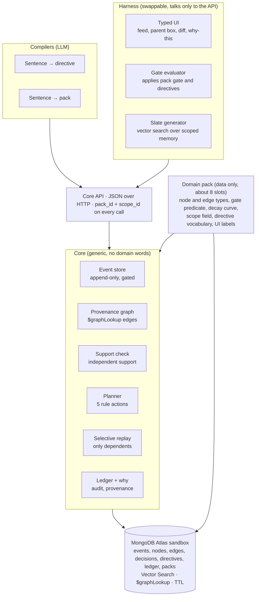
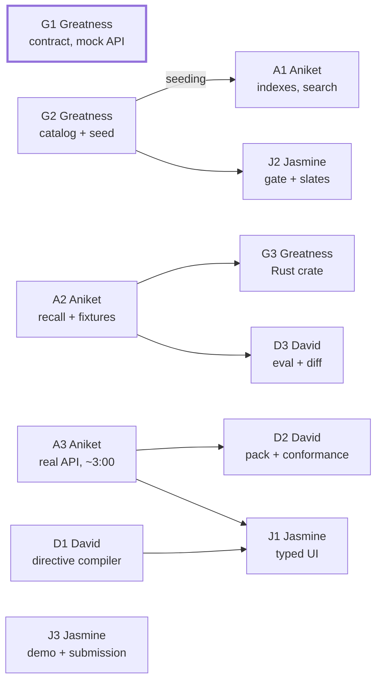

# Governed Memory Core: Technical Documentation

Snapshot of the team design doc, 14 Nov 2026. `OPS/CONTRACT.md` is the source of truth for schemas and routes; if the two disagree, the contract wins.

## 1. Overview

We are building a domain-agnostic governed-memory core on MongoDB Atlas: an agent memory where any stored fact can be traced, retracted, expired or blocked, and every decision that depended on it is repaired automatically.

Track: **Memory You Can Govern**, Agents in Context Toronto Hackathon (Sat 14 Nov 2026, submissions due 5:00 PM ET, judging from 5:15).

**The claim:** restricted content never enters memory or queued slates, and retracting one memory recalls only the decisions that depended on it. Decisions with independent support are preserved.

**Two-part demo**

1. *Generalization* (about 1 minute): Prompt → Pack → Conformance. A builder describes a domain in one sentence, an LLM fills a data-only domain pack, and a domain-neutral test suite must pass 5/5 before the pack activates.
2. *Hero use case:* a parental-monitoring video recommender with a "right to un-recommend" and "parent prompt → policy". The judge plays the parent.

**How it answers the track questions**

| Track question | Where it is answered |
| --- | --- |
| Leakage between clients or teams | Every record carries `pack_id` + `scope_id`; vector search pre-filters on scope; conformance check 3 |
| Fix or drop wrong or expired memory | Retraction planner (delete, quarantine, invalidate, replay, preserve); TTL and decay |
| Prove memory changed behavior | Receipt/diff view and LangSmith with/without-memory eval (D3) |
| Who reads, how long it lives, how forgotten | Scope rules, expiry on every directive, audit ledger, "why" API |

**Judging map:** Technical Demo 35% (end-to-end recall and the retract-one diff), Difficulty 30% (provenance graph, support check, pack compiler, conformance), Creativity 15% (plain-language parent policy, pack-from-a-sentence), Impact 20% (parents and children, plus any domain a judge names).

**Hard constraints:** finalists use the provided Atlas Sandbox; the repo is public; only work built during the event is shown; synthetic data only; none of the banned project types (Streamlit apps, basic RAG, dashboard-as-main-feature, sports analyzers or coaches, and the others in the participant guide).

## 2. Architecture



Harnesses and compilers reach the core only through the API, and the pack is plain data the core reads, so a new domain needs no core change. Enforcement (the gate, the planner, expiry) is code in the core; the LLM only fills pack and directive slots.

## 3. Data model

Seven generic collections hold everything. None has a domain word in its name or fields; domain meaning lives only in the pack's `types` and `slots` values. The exact field list is in `OPS/CONTRACT.md`, and that file wins over this table.

| Collection | Holds | Key fields | Indexes |
| --- | --- | --- | --- |
| `events` | Append-only raw observations (a view, a skip, a parent sentence) | `pack_id`, `scope_id`, `type`, `payload`, `ts`, `source` | `(pack_id, scope_id, ts)` |
| `nodes` | Memory items: facts, preferences, derived beliefs, plus a vector | `pack_id`, `scope_id`, `kind`, `text`, `embedding`, `status`, `expires_at`, `support[]` | Atlas Vector Search on `embedding` with `pack_id` and `scope_id` as filter fields; TTL on `expires_at` |
| `edges` | Typed dependencies, memory → decision | `from`, `to`, `rel`, `pack_id`, `scope_id` | `from`, `to` (for `$graphLookup`) |
| `decisions` | Actions the agent took (a slate, a ranking) with the node ids they used | `pack_id`, `scope_id`, `inputs[]`, `output`, `status`, `replay_of` | `(scope_id, ts)` |
| `directives` | Typed policies: suppress, prioritize, retract | `pack_id`, `scope_id`, `type`, `target`, `expires_at`, `cap`, `confirmed_by` | `(scope_id, type)`; TTL on `expires_at` |
| `ledger` | Audit record of every governance action | `actor`, `action`, `target`, `before`, `after`, `ts` | `(scope_id, ts)` |
| `packs` | Domain packs: data-only config | `pack_id`, `slots`, `status` (`draft` / `active`), `conformance` result | `pack_id` unique |

**Rules**

- Every read and write is filtered by `pack_id` and `scope_id`. The vector search pre-filters on scope, so a query never sees another scope's vectors.
- Memory states are `active`, `quarantined`, `invalidated`, `expired`. Nothing is hard-deleted without a ledger entry.
- Embeddings use Voyage `voyage-4-lite`. The sandbox's token allowance is for Voyage embedding and rerank only, not for chat LLMs.
- TTL indexes remove expired nodes and directives. The retraction planner also runs on expiry, so dependents of an expired memory are recalled the same way as for a manual retraction.

## 4. Recall mechanism

When one memory is wrong, expired or unwanted, recall finds every decision that depended on it, rolls back only those that lack independent support, and replays them. It follows the dependency-guided rollback repair from the arXiv paper the team attached. This is the Technical Demo centerpiece and package A2.

**Pipeline (all steps are code; the LLM takes no part):**

1. **Trace.** From the faulty node, walk `edges` with `$graphLookup` to collect every downstream node and decision (the fault's provenance set).
2. **Independent-support check.** For each affected decision, ask whether it still has at least one supporting node outside the provenance set. If yes, it is *preserved*. If no, it is a rollback candidate. The check is deliberately lenient, as the paper's own limits suggest.
3. **Plan.** Rules map each affected item to one action: `delete` (the faulty node), `quarantine` (derived beliefs awaiting review), `invalidate` (decisions that lost all support), `replay` (decisions to recompute), or `preserve`.
4. **Replay.** Recompute only the invalidated decisions, with the faulty node excluded, and write new decisions with `replay_of` pointing at the old ones.
5. **Ledger.** Every action is written to `ledger`, and the "why" API can answer "why was this recommended?" and "what did retracting X change?" from it.

**Output of a plan** (JSON, identical for the Python reference and the Rust crate):

```json
{
  "fault": "node_123",
  "actions": [
    {"id": "node_123", "action": "delete"},
    {"id": "node_201", "action": "quarantine"},
    {"id": "dec_77",  "action": "invalidate"},
    {"id": "dec_77",  "action": "replay"},
    {"id": "dec_80",  "action": "preserve", "reason": "independent_support"}
  ]
}
```

**Known limits (from the paper, to say out loud in the demo):** recall needs instrumented provenance (we write edges at decision time), an upstream fault detector (the parent, a directive or TTL supplies it), resettable side effects (recommendations are recomputable), and a lenient support check. Stale-fault repair works best when the fault recurs, so the demo uses a scripted curve.

## 5. Compilers

One LLM compiler pattern is used twice. The LLM only fills typed slots. A validator checks the output, a human confirms it, and code (never the LLM) enforces the gate and the planner.

**Compiler 1: parent sentence → directive (David, D1)**

- Input: "No scary stuff for my 7-year-old until the weekend."
- Output: a typed directive, one of three primitives: `suppress` (with expiry), `prioritize` (with a cap), `retract`.
- Precedence when directives collide: **gate > block > boost**.
- Writes need a PIN-gated confirm step: the UI shows the parsed directive in plain words, the parent approves with the PIN, and only then does it reach `directives`.
- Injection tests: a sentence that tries to disable the gate, widen scope or remove expiry must fail validation.

**Compiler 2: builder sentence → domain pack (David, D2)**

- Input: one sentence describing a domain (for example a different recommender or a team-memory assistant).
- Output: a pack of about 8 slots, as data only: node and edge `types`, the gate predicate, the decay curve, the scope field, the directive vocabulary, and labels for the UI.
- Fallback: a cached, previously validated pack is served if the LLM call fails or the token budget is spent.

**Validation, for both compilers**

1. JSON-schema validation against the contract. Reject on any extra or missing field.
2. Referential checks (every edge type names a declared node type; every directive target exists).
3. Human confirm: PIN for parents, an explicit "activate" for builders. The pack only activates if the conformance suite passes 5/5.

**LLM setup:** `get_llm()` (in `shared/llm.py`) reads provider, model and key from environment variables. Primary is Groq `openai/gpt-oss-120b`, with strict structured output via `method="json_schema"`. Fallback is OpenRouter through the OpenAI-compatible base URL. Details in section 9.

## 6. Conformance suite

A pack activates only when all 5 domain-neutral checks pass. The suite runs against the pack's own seeded data and uses no domain words, so the same code tests any pack. Owner: David (D2).

| # | Check | Passes when |
| --- | --- | --- |
| 1 | Retraction recalls dependents | Retracting a seeded node invalidates every decision that depended only on it |
| 2 | Independent support preserved | A decision with a second supporting node outside the fault's provenance set survives retraction |
| 3 | No cross-scope reads | A query in scope A returns nothing from scope B, including through vector search |
| 4 | Expiry removes memory and dependents | After a node's `expires_at`, it and its dependent decisions are recalled |
| 5 | Gated content never enters memory | An item the gate rejects creates no node, no edge and no queued slate entry |

**Generalization tiers** (what we show, in order of risk):

- **Floor:** a second, hand-written pack passes 5/5 on the same core, proving the core holds no domain words.
- **Target:** the LLM generates a pack from one sentence and it passes 5/5 live, with a cached pack as fallback.
- **Bonus:** a judge names a domain and we generate and test it on stage.

## 7. API contract

The harness, compilers and UI talk to the core only through these routes. See `OPS/CONTRACT.md` for exact shapes; `mock/app.py` serves canned responses. Every body is JSON and every request carries `pack_id` and `scope_id`.

| Route | Purpose | Caller |
| --- | --- | --- |
| `POST /packs` | Register a draft pack (slots as data) | Pack compiler (D2) |
| `POST /packs/{id}/conformance` | Run the 5 checks, return per-check pass/fail | Pack compiler (D2) |
| `POST /packs/{id}/activate` | Activate only if the last conformance run was 5/5 | UI (J1) |
| `POST /events` | Append an observation; passes the gate first | Harness (J2) |
| `POST /memory/search` | Scope-filtered vector search over `nodes` | Harness (J2) |
| `POST /decisions` | Record a decision with its input node ids; writes edges | Harness (J2) |
| `POST /directives` | Create a confirmed directive (suppress, prioritize, retract) | Directive compiler (D1) |
| `POST /retract` | Retract a node or directive; returns the plan and the replay result | UI (J1) |
| `GET /why/{decision_id}` | Provenance and ledger entries for a decision | UI (J1) |
| `GET /diff?retract={id}` | With/without diff of slates after a retraction | UI (J1), eval (D3) |
| `GET /ledger` | Audit entries for a scope, newest first | UI (J1) |

**Conventions**

- Errors return `{"error": {"code": "...", "detail": "..."}}` with a stable `code`.
- IDs are strings. Timestamps are ISO 8601 UTC.
- A gated event returns `200` with `{"admitted": false, "reason": "..."}`. Nothing is written to `nodes` or `edges`.
- `POST /retract` and `GET /diff` return the same plan JSON shown in section 4, so the Python and Rust planners are interchangeable.

## 8. Hero use case: parental-monitoring video recommender

A child's feed is built from watch memory. The parent can say, in plain words, what the feed should and should not do, and can un-recommend anything with a visible, provable effect. The judge plays the parent. This is a **harness** on the generic core, not part of it.

**Pieces (Jasmine's harness, using Greatness's data)**

- **Catalog:** about 200 synthetic videos with a taxonomy (topic, maturity level, tags). No real children's data; all watch history is scripted curves. (G2)
- **Gate evaluator:** a generic evaluator that reads the pack's gate predicate and the active directives. Restricted content is quarantined *before* it can create a memory or enter a queued slate. (J2)
- **Slate generator:** builds the next slate from `$vectorSearch` over scoped memory, then applies precedence gate > block > boost. (J2)
- **UI:** a light JavaScript front end, not Streamlit and not a dashboard. It has a child feed, a parent box with a PIN confirm card, a receipt/diff view and a "why this?" action. (J1)

**Demo beats (about 3 minutes)**

1. The child feed shows a slate shaped by watch history.
2. The parent types a sentence. The compiler shows the parsed directive; the PIN approves it; the next slate changes and a receipt lists what was blocked.
3. The parent hits "un-recommend" on a video. Recall runs: only the dependent slate items are replaced, and an independently supported item is shown as preserved.
4. The diff view shows the slate with and without the retracted memory.
5. "Why this?" shows the provenance chain and the ledger entries.

**Boundaries:** synthetic data only; the PIN is a demo gate, not real authentication; the system makes no claim about child safety beyond what the gate and directives enforce.

## 9. Stack, LLM providers and environment

**Stack**

| Layer | Choice | Notes |
| --- | --- | --- |
| Database | MongoDB Atlas (the hackathon Sandbox) | `$vectorSearch` with scope pre-filter, `$graphLookup`, TTL indexes, schema validation, change streams |
| Core language | Python (PyMongo, FastAPI) | The spine |
| Embeddings | Voyage `voyage-4-lite` | Covered by the sandbox's Voyage allowance |
| Orchestration | LangChain / LangGraph | LangChain is an adapter layer, not a model |
| Tracing | LangSmith | Free Developer plan: 1 seat, 5k base traces a month, 14-day retention |
| Voice | ElevenLabs | Stretch only; free plan has 10,000 credits a month and no commercial licence |
| Front end | Light JavaScript | Not Streamlit; not a dashboard |
| Rust | `recall-core` crate (G3) | Optional; see section 10 |

**Which LLM, and why not the sandbox:** the sandbox's token allowance covers Voyage embeddings and reranking only, so chat completions need another provider.

- **Primary: Groq** `openai/gpt-oss-120b`. Strict structured output works on gpt-oss models via `method="json_schema"` (langchain-groq 0.3.8 or newer); it does not combine with streaming or tool use. Verified limits from our Groq console (14 Nov): 30 requests a minute, 1,000 requests a day, **8,000 tokens a minute** and 200,000 tokens a day. `openai/gpt-oss-20b` shows the same limits as its own row, so it is a candidate overflow model (confirm that limits are tracked per model before relying on it).
- **Fallback: OpenRouter.** OpenAI-compatible, so it is a base-URL swap. `:free` models are limited to 20 requests a minute and 50 a day, or 1,000 a day after a one-time purchase of at least $10 in credits. Free models can change or disappear without notice.
- **Tokens bind before requests do.** The 8,000 tokens a minute cap allows about 3 compiler calls a minute at 2 to 3k tokens each, so use short retry and backoff. The 200,000 daily tokens allow roughly 70 to 80 calls a day (our estimate). Keep prompts compact, cache validated outputs, and reserve a fresh budget before judging.

**Environment variables** (in `.env`, never committed; `.env.example` with empty values is committed)

```bash
MONGODB_URI=
VOYAGE_API_KEY=
LLM_PROVIDER=groq            # groq | openrouter
LLM_MODEL=openai/gpt-oss-120b
GROQ_API_KEY=
OPENROUTER_API_KEY=
LANGSMITH_API_KEY=
LANGSMITH_TRACING=false      # set true once LANGSMITH_API_KEY is filled in
ELEVENLABS_API_KEY=
```

`get_llm()` returns a LangChain chat model from `LLM_PROVIDER`, `LLM_MODEL` and the matching key, so switching providers is an env change, not a code change.

## 10. Rust `recall-core` crate

Rust is optional and must never be on the critical path. Greatness (G3) builds a small pure-logic crate that implements the retraction planner, and the demo works without it.

- **Interface:** a CLI that reads the graph and fault as JSON on stdin and writes the plan JSON from section 4 on stdout. PyO3 bindings only if time allows.
- **Reference:** the Python planner (A2) is the source of truth. The two must produce identical plans on the shared fixture files; those fixtures double as the crate's tests.
- **Why it earns its place:** it shows the mechanism is language-neutral and fast on large graphs, which supports Difficulty without adding risk.
- **Go/no-go at 3:00 PM:** if the crate does not match the fixtures by then, drop it and keep the Python planner. Nothing else depends on it.
- **Layout:** `rust/recall-core/` (`Cargo.toml`, `src/`, `tests/fixtures/`); `target/` is gitignored.

## 11. Work packages and dependencies



Arrow means "waits on". G1 gates integration for everyone. Drop G3 first if time slips; nothing depends on it.

| Package | Owner | Scope | Waits on |
| --- | --- | --- | --- |
| G1 | Greatness | Repo hygiene, scaffold, `CLAUDE.md` and OPS files, env and `get_llm()`, contract v0, mock API | Nothing |
| G2 | Greatness | 200-video catalog, taxonomy, scripted user curves, seed loader | G1 scaffold |
| G3 | Greatness | Rust `recall-core` crate, go/no-go at 3:00 PM | A2 fixtures |
| A1 | Aniket | Atlas collections, indexes, scoped vector search, ledger and TTL | G2 for seeding only |
| A2 | Aniket | Provenance graph, support check, planner, replay (Python), plus JSON fixtures | Nothing |
| A3 | Aniket | Real core API replacing the mock (about 3:00 PM) | A1, A2 |
| D1 | David | Directive compiler (3 types), PIN-gated writes, confirm step, injection tests | G1 contract |
| D2 | David | Pack compiler with cached fallback, 5-check conformance suite | G1 contract; A3 for live runs |
| D3 | David | LangSmith tracing, 25-prompt dataset, with/without-memory eval, retract-one diff | A2 |
| J1 | Jasmine | Typed UI: child feed, parent box with PIN card, receipt/diff, why-this | G1 mock, A3; D1 for the parent box (about 3:15 PM) |
| J2 | Jasmine | Generic gate evaluator, restricted-content quarantine, slate generator | G2 catalog |
| J3 | Jasmine | Demo script, 1-minute video, README, submission form, fallbacks | Everything, late |

**Gates:** about 2:00 PM contract and pack schema frozen; 3:00 PM recall works end to end; 3:45 PM compiler, UI and PIN working; 4:15 PM feature freeze; submit by 4:45 PM, ahead of the 5:00 PM deadline.

## 12. Claude Code kit

Everyone works in their own Claude Code harness, so the repo carries the rules and the coordination files. See `CLAUDE.md`, `OPS/` and `.claude/skills/`.

**`CLAUDE.md` rules**

- The core has no domain words. Domain meaning lives only in pack data.
- The LLM never enforces the gate or the planner; code does.
- Python is the spine. Rust and JavaScript talk to it through the contract.
- Keys live in environment variables only. All data is synthetic.
- Respect the banned-project list from the participant guide.
- Edit only your own directories. Never force-push `main`.

**Directory ownership**

| Directory | Owner |
| --- | --- |
| `core/` | Aniket |
| `rust/`, `data/`, `OPS/`, `scripts/`, `mock/`, `shared/` | Greatness |
| `compiler/`, `eval/` | David |
| `harness/`, `ui/` | Jasmine |

**`OPS/` files:** `CONTRACT.md` (single source for collections, routes, schemas), `OWNERS.md`, `STATUS.md` (one line per package), `BLOCKERS.md` (append-only), `KICKOFF.md` (start steps and the kickoff prompt).

**Skills in `.claude/skills/`:** `handoff`, `precommit-check` (secret scan, domain-word grep in `core/`, tests), `contract-check`.

## 13. Evaluation, observability and demo script

The track asks us to prove memory changed behavior. D3 (David) produces that proof, and J3 (Jasmine) turns it into the demo.

**Evaluation (D3)**

- A LangSmith dataset of 25 prompts (parent sentences, retractions, gated items).
- Each run is traced twice, with memory and without, and the slate diff is stored as the evidence.
- The headline test is **retract one**: remove a single memory, then show that only its dependents changed and independently supported items did not.
- Every governance action is also in `ledger`, so the evidence does not depend on LangSmith retention (14 days on the free plan).

**Demo script (J3), in order**

1. One sentence of framing: "Memory you can govern: fix it, expire it, prove it."
2. Generalization: type a domain sentence → pack appears → conformance 5/5 → activate (cached pack if the LLM is slow).
3. Hero: the five beats in section 8.
4. Close on the track questions: leakage (scope), fix or drop (recall), prove (diff), who reads and how long (ledger and expiry).

**Submission checklist:** public repo with README and `.gitignore`; sandbox-backed run; 1-minute video; submission form before 5:00 PM ET; backup recording in case the live demo fails.

## 14. Risks, fallbacks and open items

| Risk | Likelihood / impact | Fallback |
| --- | --- | --- |
| G1 (contract, mock API, scaffold) runs late and blocks everyone | Medium / High | Others build against the contract draft; Greatness drops G3 first |
| LLM compiler output is invalid or the provider is down | Medium / High | Validator rejects it; cached validated directive and pack; switch `LLM_PROVIDER` |
| Free-tier token cap hit before judging | Medium / High | Compact prompts, cached outputs, reserved fresh budget, OpenRouter credit |
| Live pack generation fails conformance on stage | Medium / Medium | Cached pack; hand-written second pack proves the core is domain-free |
| Support check is too strict or too lenient on real graphs | Medium / Medium | Scripted seed curves with known answers; fixtures shared by Python and Rust |
| Rust crate does not match Python by 3:00 PM | Medium / Low | Drop it; no other package depends on it |
| Secret leaked into the public repo | Low / High | `.gitignore` first; `precommit-check` skill; rotate any key that is pushed |
| Scope creep into a dashboard | Medium / Medium | Feature freeze at 4:15 PM; UI limited to the five demo beats |

**Open items**

- [x] `.gitignore`, scaffold, contract v0.1 and mock API merged (G1).
- [ ] Buy the $10 OpenRouter credit with a spend cap (not blocking; before 3:00 PM).
- [ ] A teammate runs one `with_structured_output` call on Groq `gpt-oss-120b` to confirm strict JSON works.
- [ ] Check the participant guide's partner-resources section for extra credits.
